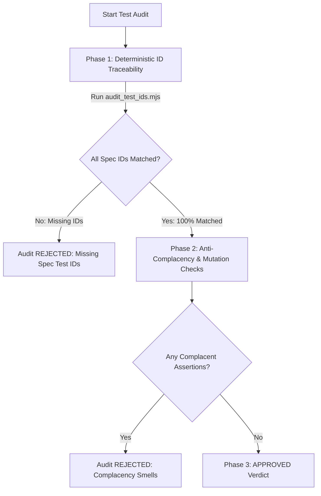

# Test Audit & Spec Traceability Skill

This skill defines the operational procedure and automated tooling used by agents (particularly `test-auditor`) to verify test completeness, non-complacency, and strict bidirectional traceability between `specs/` and test suites.

---

## 1. Traceability Architecture

In this codebase, every testable acceptance criterion in `specs/` is assigned an immutable uppercase test identifier:
`TEST-<DOMAIN>-<COMPONENT>-<NUMBER>` (e.g. `TEST-DOMAIN-BBOX-01`, `TEST-SRV-ASSET-03`, `TEST-UI-STORAGE-05`).

Every test suite verifying a component or service MUST label each test case explicitly with its assigned ID:
```typescript
test('TEST-SRV-ASSET-01: createAsset validates input, generates UUID v4, and persists aggregate', async () => {
  // ...
});
```

An audit **CANNOT pass** if any test ID defined in the relevant specification document is omitted or unverified.

---

## 2. Audit Workflow

When auditing tests for a feature, package, or pull request, follow this three-phase procedure:



### Phase 1: Deterministic ID Traceability Verification

Before analyzing test code manually, execute the bundled traceability auditor script using `run_command`:

```bash
# 1. Audit a specific spec file
node .agents/skills/test-audit/scripts/audit_test_ids.mjs --spec=specs/server/asset_service.md

# 2. Audit an architectural domain
node .agents/skills/test-audit/scripts/audit_test_ids.mjs --scope=server

# 3. Generate Markdown table for report
node .agents/skills/test-audit/scripts/audit_test_ids.mjs --scope=server --format=markdown

# 4. Strict CI / Gate mode (exits non-zero if missing IDs)
node .agents/skills/test-audit/scripts/audit_test_ids.mjs --scope=domain --strict
```

#### Supported Scopes
* `--scope=domain`: Pure domain contracts and bounding box math (`specs/domain/`).
* `--scope=server`: Repositories, domain services, RPC adapters, and image export (`specs/server/`).
* `--scope=ui`: React state stores, viewport storage, UI panels, and design system components (`specs/ui/`).
* `--scope=all`: Monorepo-wide scan.

#### Triage Criteria
1. **Missing Spec IDs**: Declared in `specs/` but absent from test suites.
   * **Action**: Audit must immediately fail with `REJECTED (Missing Spec Test IDs)`. Demand implementing the missing test cases.
2. **Orphan Tests**: Tests tagged with `TEST-*` that do not exist in `specs/`.
   * **Action**: Flag for specification update (e.g. `TEST-SRV-HLTH-*` needs indexing in `health_check.md`).
3. **Unit vs. BDD Scenarios**:
   * Pure domain logic, repositories, and state stores belong in fast unit/integration suites (`*.test.ts`).
   * High-level user journeys belong in Gherkin feature files (`*.feature`).
   * If a spec defines `TEST-*` acceptance criteria for a service or store, they must be represented in unit tests.

---

### Phase 2: Anti-Complacency Inspection

Once all test IDs are present, inspect each test block to ensure assertions are non-complacent:

1. **Mental Mutation Check**:
   * If the function under test returns `null`, empty array, or skips a mutation, does the test turn RED?
   * If the test still passes, flag it as **Complacent (False Green)**.
2. **Assertion Strictness**:
   * Ban shallow checks: `expect(res).toBeDefined()`, `expect(Array.isArray(x)).toBe(true)`, or loose truthiness.
   * Require deep equality: `toEqual({ ... })`, `toStrictEqual(...)`, exact lengths, specific error classes/codes.
3. **Side-Effect Verification**:
   * For mutating operations (e.g., repository `update`, `paintArea`, store persistence), verify that storage or downstream state actually recorded the change.
4. **Mock Realism**:
   * Ensure mocks do not replace the actual code under test.

---

### Phase 3: Structured Audit Report

Format the audit deliverable according to this schema:

```markdown
# Test Audit Report

**Scope**: [domain / server / ui / file]
**Audit Verdict**: APPROVED | REJECTED (Missing Spec Test IDs) | REJECTED (Complacency Smells Detected)

## 1. Spec Test ID Traceability
[Include table from audit_test_ids.mjs --format=markdown]

## 2. Smell Breakdown (if rejected)
- **Test ID**: `TEST-SRV-ASSET-03`
- **Location**: `[asset_service.test.ts#L94](file:///...)`
- **Smell Type**: *Weak Assertion*
- **Vulnerability**: Asserted only that call didn't throw, but failed to assert that cells outside downsized dimensions were trimmed.
- **Actionable Remedy**: Assert exact cell count and remaining coordinates in repository after update.

## 3. Missing Scenarios & Action Items
- Implement missing test case for `TEST-SRV-EXP-01` in `packages/server/test/image_export_service.test.ts`.
```
