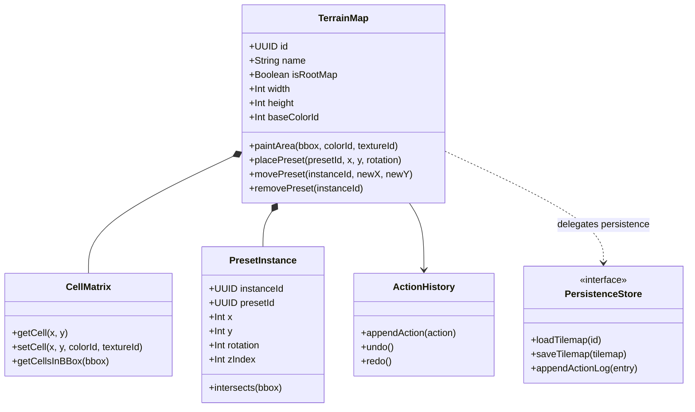

# Domain Core Specification

This document describes the conceptual domain model, active in-memory aggregates, and the boundary abstraction with infrastructure adapters.

---

## 1. Domain Principles & Aggregates (DDD)

The **Engine Core** is strictly independent of UI frameworks and network transports. It manages spatial logic, invariants, and validation rules.



### 1.1 The `TerrainMap` Root Aggregate (Unified Map & Presets)
* **Aggregate Root**: Every terrain resource (the main $118 \times 225$ mat as well as reusable $6 \times 8$ presets) is an instance of `TerrainMap`.
* **Invariants enforced by the aggregate**:
  * Coordinate boundaries: No cell or preset instance may be placed outside $0 \le x < \text{width}$ and $0 \le y < \text{height}$.
  * Color validity: Any color identifier must exist within the official LEGO palette.
  * Alpha Channel: A cell without a defined color (`colorId = null`) represents transparency.

### 1.2 The `ActionHistory` Aggregate (Event Sourcing & Undo/Redo)
* Every terrain mutation (brush painting, placing, moving, or deleting a preset) is recorded as an immutable log entry alongside its inverse compensation payload (Rollback).
* `undo()` and `redo()` execute predictably and deterministically.

---

## 2. Port Abstraction: `PersistenceStore` (Black Box)

The domain contains no SQL queries. To load or persist state, it communicates through an abstract service contract:

```
[ TerrainMap (Domain) ] ──> calls ──> [ PersistenceStore (Abstract Port) ]
                                                ▲
                                                │ Implemented by
                                 [ SQLiteStore (Physical Adapter) ]
```

The formal contract for this service is defined in [`persistence.proto`](./persistence.proto) (along with domain models in [`domain.proto`](./domain.proto) and public API in [`api.proto`](./api.proto)).
The domain treats this interface as a black box ensuring atomic transactions and durability.
