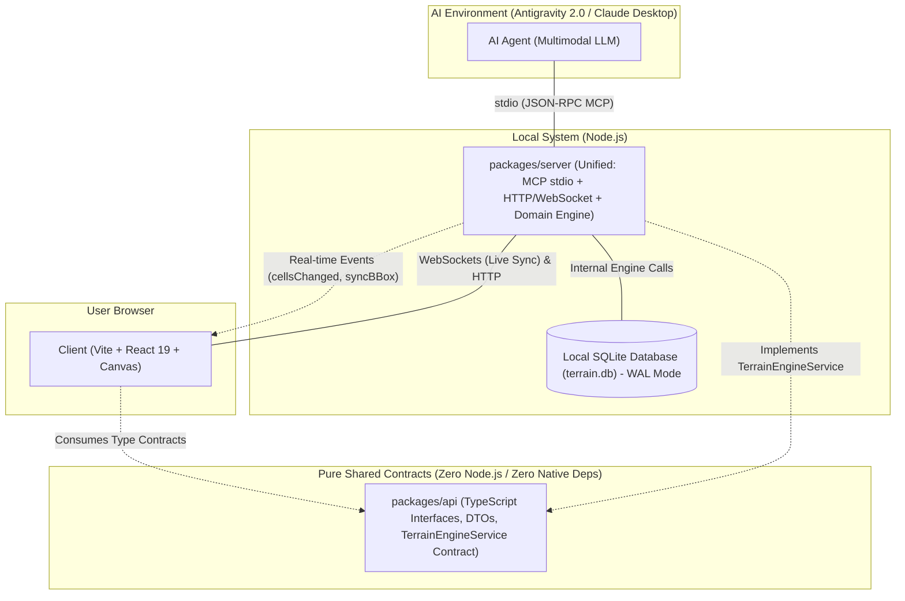

# System Architecture & Monorepo Layout

This document describes the overall technical architecture of **LEGO Wargame Terrain Studio**, the 3-package monorepo organization, communication flows, and data boundaries.

---

## 1. High-Level Architecture Overview

### Key Principles:
1. **Strict Code vs. Data Boundary**:
   * Application source code lives in git.
   * Game data (`terrain.db`) is a local binary SQLite database managed by the engine. AI agents never edit database files using text-replacement tools.
2. **Pure Contract Isolation (`packages/api`)**:
   * Contains only pure TypeScript DTOs, domain entity types, and the `TerrainEngineService` interface.
   * Zero runtime dependencies, zero Node.js/C++ native modules, safely importable in browser sandboxes.
3. **Unified Backend Engine (`packages/server`)**:
   * Hosts domain aggregates (`TerrainMap`, `CellMatrix`, `ActionHistory`), SQLite WAL persistence (`better-sqlite3`), MCP tools for AI communication (`stdio`), and local WebSocket live synchronization.
   * Directly implements `TerrainEngineService` and hosts the JSON-RPC dispatcher.
4. **Decoupled Frontend Client (`packages/client`)**:
   * High-performance React 19 + Canvas viewport connecting via `TerrainEngineServiceClient` over a decoupled transport (`JsonRpcTransport`).

---

## 2. Monorepo Package Breakdown

* **`packages/api`**: Pure shared contract package containing Protobuf DTOs (`domain.proto`, `api.proto`) and the `TerrainEngineService` interface.
* **`packages/server`**: Unified local server and domain engine hosting domain logic, SQLite WAL adapter, export generators (SVG polygon merging & raster 300 DPI), MCP tools, and WebSocket bridge.
* **`packages/client`**: React SPA frontend with Canvas viewport, Bounding Box selection overlay, and official LEGO color pickers.
* **`packages/codegen`**: Build-time tooling compiling declarative schemas in `specs/` into typed TypeScript contracts and SQL migrations.
