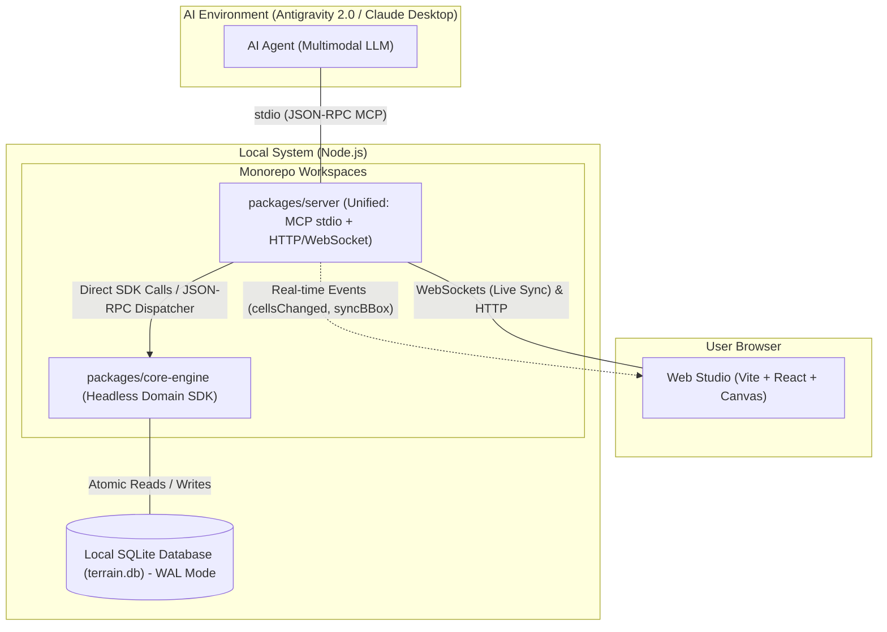

# System Architecture & Monorepo Layout

This document describes the overall technical architecture of **LEGO Wargame Terrain Studio**, the 3-package monorepo organization, communication flows, and data boundaries.

---

## 1. High-Level Architecture Overview

### Key Principles:
1. **Strict Code vs. Data Boundary**:
   * Application source code lives in git.
   * Game data (`terrain.db`) is a local binary SQLite database managed by the engine. AI agents never edit database files using text-replacement tools.
2. **Headless Domain SDK (`core-engine`)**:
   * Contains spatial grid logic, event sourcing, export engines, and abstract storage interfaces.
3. **Unified Server (`server`)**:
   * Hosts the MCP server for AI communication (`stdio`) and the local HTTP/WebSocket server for the browser in a single Node.js runtime, enabling instantaneous live screen synchronization.
4. **Decoupled Frontend (`web-studio`)**:
   * High-performance React + Canvas viewport connecting via `IEngineGateway`.

---

## 2. Monorepo Package Breakdown

* **`packages/core-engine`**: Headless domain SDK, spatial index, SQLite WAL adapter, export generators (SVG polygon merging & raster 300 DPI).
* **`packages/server`**: Unified local server hosting MCP tools and WebSocket live-sync bridge.
* **`packages/web-studio`**: React SPA frontend with Canvas viewport, Bounding Box selection overlay, and official LEGO color pickers.
