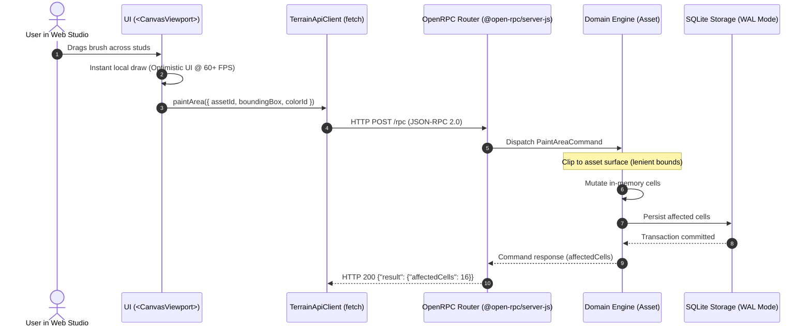
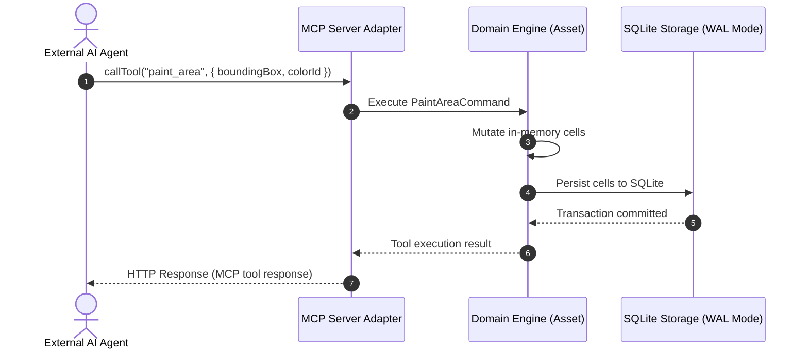

# End-to-End Data Flows

This document details the sequence and boundaries of data flows across the system layers for user interactions and external AI agent tool execution.

---

## 1. Flow A: User Direct Interaction (Optimistic Canvas + HTTP JSON-RPC)

When the user draws on the interactive HTML5 2D canvas:

---

## 2. Flow B: External AI Mutation via MCP (Streamable HTTP)

When an external AI agent manipulates an asset via MCP tooling:

