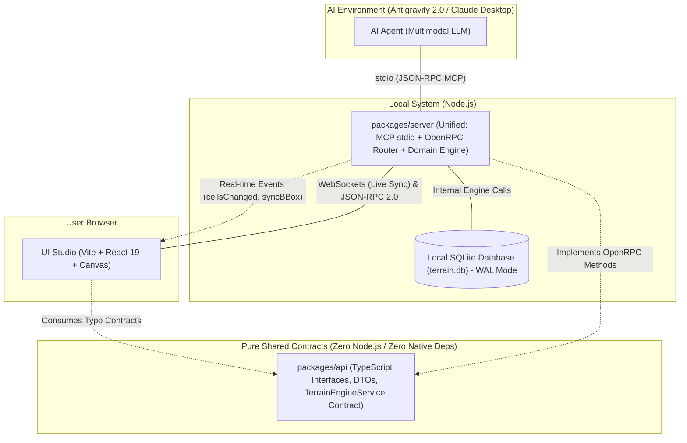

# System Architecture & Monorepo Layout

This document describes the technical architecture of **LEGO Wargame Terrain Studio**, the monorepo package topology, communication flows, and system boundaries.

---

## 1. High-Level Architecture Overview

---

## 2. Monorepo Package Breakdown

* **`packages/api`**: Pure shared contract package containing domain DTOs and the `TerrainEngineService` interface compiled from JSON Schema.
* **`packages/server`**: Unified local server hosting domain logic, SQLite WAL persistence, OpenRPC JSON-RPC 2.0 router with schema validation, and MCP tools over stdio.
* **`packages/ui`**: React 19 SPA frontend with high-performance Canvas viewport, Bounding Box selection overlay, and official LEGO color pickers.
* **`packages/codegen`**: Build-time tooling compiling declarative schemas in `specs/` into typed TypeScript contracts and SQL migrations.
