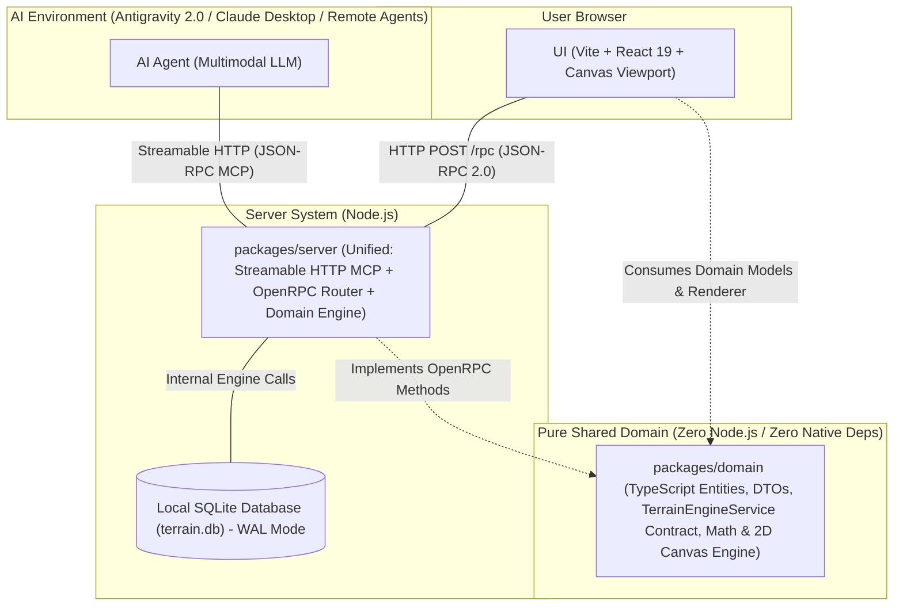

# System Architecture & Monorepo Layout

This document describes the technical architecture of **Brick Wargame Terrain Studio**, the monorepo package topology, communication flows, and system boundaries.

---

## 1. High-Level Architecture Overview

---

## 2. Monorepo Package Breakdown

* **`packages/domain`**: Pure shared domain package containing domain entities, DTOs, the `TerrainEngineService` interface compiled from JSON Schema, pure bounding box math, and the shared 2D canvas rendering engine.
* **`packages/server`**: Server hosting domain logic, SQLite WAL persistence, OpenRPC JSON-RPC 2.0 router with schema validation, and streamable HTTP MCP tools (ready for remote or local hosting).
* **`packages/ui`**: React 19 SPA frontend with high-performance HTML5 2D Canvas viewport, Minimap, Bounding Box controls, and official brick color pickers.
* **`packages/codegen`**: Build-time tooling compiling declarative schemas in `specs/` into typed TypeScript contracts and SQL migrations.
