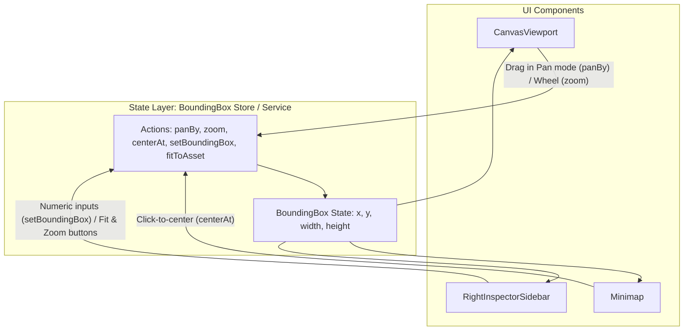

# UI Architecture: Viewport & Bounding Box State Management

## 1. Overview & Architectural Role

In **Brick Wargame Terrain Studio**, the active editing viewport is defined by a rectangular subregion of the terrain asset called the **Bounding Box** $(x, y, width, height)$.

This state coordinates three distinct visual and interactive subsystems in real time:
1. **`<CanvasViewport>`**: Renders the subregion defined by $[x, x + width - 1] \times [y, y + height - 1]$ scaled to best fit the screen, and generates pan/drag offsets and mouse wheel zoom increments.
2. **`<Minimap>`**: Renders the whole asset ($W \times H$) with an active indicator frame, and triggers center repositioning upon click.
3. **`<RightInspectorSidebar>`**: Displays and accepts direct numeric input for $x, y, width, height$, plus preset buttons (`Fit to Asset`, `Zoom In`, `Zoom Out`).

To avoid tight coupling, prop drilling, and duplicated clamping logic across components, bounding box state and its manipulation operations are encapsulated in a dedicated state management service / store.

---

## 2. State Model & Invariants

### 2.1 State Structure
The bounding box viewport state relies directly on the standard domain **`BoundingBox`** model (defined in [`specs/domain/schemas/model.yaml`](../domain/schemas/model.yaml)):
* **`x`**: Top-left column coordinate in asset stud coordinates ($0 \le x < W$).
* **`y`**: Top-left row coordinate in asset stud coordinates ($0 \le y < H$).
* **`width`**: Horizontal framed span in studs ($1 \le width \le W$).
* **`height`**: Vertical framed span in studs ($1 \le height \le H$).

In addition to the bounding box coordinates, the state management service tracks the **active asset dimensions** $(W, H)$ to enforce dynamic boundary limits:
* **`assetWidth` ($W$)**: Total horizontal studs of the active asset.
* **`assetHeight` ($H$)**: Total vertical studs of the active asset.

### 2.2 Mathematical Invariants
At all times, the state MUST satisfy:
1. **Boundary Clamping**:
   $$0 \le x \le W - width$$
   $$0 \le y \le H - height$$
2. **Dimension Constraints**:
   $$1 \le width \le W$$
   $$1 \le height \le H$$
3. **Integer Grid Alignment**: All values are integers ($\mathbb{Z}$).

---

## 3. Operations & State Transitions

The bounding box state is updated exclusively through declarative actions that delegate mathematical calculations and boundary clamping to the pure domain operations defined in [`specs/domain/bounding_box_math.md`](../domain/bounding_box_math.md) (exported by `@lego-wargame-terrain-studio/api`):

| Action | Parameters | Delegated Domain Function |
| :--- | :--- | :--- |
| `initialize` | Bounding box $(bbox)$ and dimensions $(W, H)$ | `clampBoundingBox(bbox, W, H)` |
| `setBoundingBox` | Partial coordinates $(x, y, width, height)$ | `clampBoundingBox(merged, W, H)` |
| `panBy` | Stud offsets $(\Delta x, \Delta y)$ | `panBoundingBox(current, deltaX, deltaY, W, H)` |
| `centerAt` | Target coordinates $(C_{\text{target}}, R_{\text{target}})$ | `centerBoundingBoxAt(C_target, R_target, width, height, W, H)` |
| `zoom` | Scale factor $f$ | `zoomBoundingBox(current, factor, W, H)` |
| `fitToAsset` | None | `clampBoundingBox({ x: 0, y: 0, width: W, height: H }, W, H)` |
| `syncAssetDimensions` | New dimensions $(W, H)$ | `clampBoundingBox(current, newW, newH)` |

---

## 4. Component Interaction Flow

---

## 5. Persistence Integration: Self-Contained State Store

The bounding box state store is **self-contained**: it accepts the active asset context (`assetId`, `assetWidth`, `assetHeight`) and a `ViewportStorageService` reference, internally managing its own lifecycle, restoration, and debounced persistence:

### 5.1 Inputs & Dependencies
* **Active Asset Context**: `assetId`, `assetWidth`, `assetHeight`.
* **Storage Adapter**: An instance of `ViewportStorageService` (defaults to production `LocalStorageViewportStorage`, or `MemoryViewportStorage` for testing).

### 5.2 Internal Lifecycle & Automation
1. **Automated Loading on Asset Mount / Switch**:
   * Whenever `assetId` changes, the store automatically queries `storage.loadBoundingBox(assetId, assetWidth, assetHeight)`.
   * If a stored bounding box exists and is valid (or healed by the recovery algorithm), the store sets that region as the active bounding box.
   * If `null` is returned (no entry or unrecoverable), the store automatically defaults to `fitToAsset()` $(0, 0, W, H)$.
2. **Automated Debounced Persistence on Updates**:
   * Whenever the bounding box state transitions (via `panBy`, `zoom`, `centerAt`, or `setBoundingBox`), the store automatically calls `storage.saveBoundingBox(assetId, boundingBox)`.
   * Saves are debounced to prevent performance degradation and storage thrashing during continuous user interactions (such as dragging or mouse wheel scrolling).
3. **Asset Resize Synchronization**:
   * When `assetWidth` or `assetHeight` changes for the current asset, the store re-clamps the current bounding box via domain `clampBoundingBox` and auto-persists the adjusted values.
4. **Asset Deletion Cleanup**:
   * When an asset is permanently deleted, the application invokes `storage.removeBoundingBox(assetId)` to purge orphaned entries.

### 5.3 Architectural Rationale
By encapsulating storage and lifecycle within the store:
* View components (`<CanvasViewport>`, `<Minimap>`, `<RightInspectorSidebar>`, and root `<StudioApp>`) remain clean and declarative without boilerplate `useEffect` hooks, debouncing timers, or manual I/O calls.
* Unit tests for UI interactions can easily inject `MemoryViewportStorage` to verify persistence and restoration in complete isolation from browser globals.

---

## 6. Acceptance Criteria & Test IDs

* `TEST-UI-BBOX-01`: Bounding box origin and dimensions are clamped strictly within asset bounds at all times.
* `TEST-UI-BBOX-02`: Bounding box state is synchronized simultaneously across CanvasViewport, Minimap indicator, and Inspector inputs.
* `TEST-UI-BBOX-03`: When the store mounts with or switches to an asset ID, it automatically loads and restores the stored bounding box from the storage service.
* `TEST-UI-BBOX-04`: When loading an asset without a stored bounding box, the store defaults to framing the entire asset $(0, 0, W, H)$.
* `TEST-UI-BBOX-05`: State changes in the store automatically trigger a debounced save to the storage service for the active asset ID.
* `TEST-UI-BBOX-06`: Changing asset dimensions automatically re-clamps the active bounding box within the new boundaries and persists the healed state.
