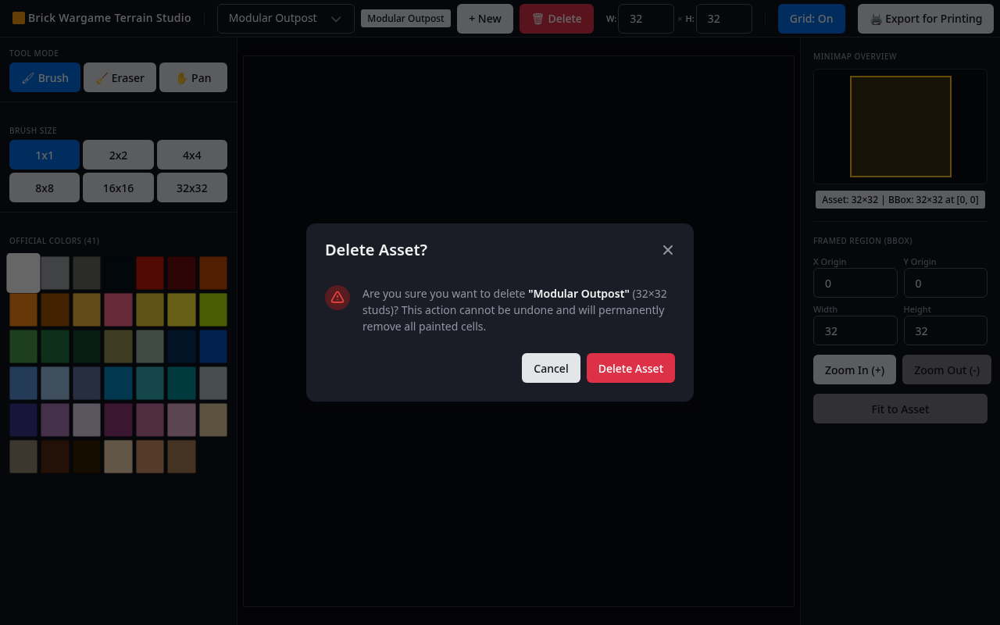

# Component: DeleteAssetModal

## 1. Role & Responsibilities
The `<DeleteAssetModal>` is an accessible confirmation modal dialog triggered when the operator clicks the `[Delete]` button in `<TopHeaderBar>`. Its purpose is to prevent accidental permanent deletion of terrain assets and their painted brick cells.

---

## 2. Component Contract

### Input Props
| Prop | Type | Description |
| :--- | :--- | :--- |
| `isOpen` | Boolean | Whether the confirmation dialog is currently open |
| `assetName` | String | Display name of the asset targeted for deletion |
| `width` | Integer | Width in studs of the targeted asset |
| `height` | Integer | Height in studs of the targeted asset |

### Callbacks
| Callback | Arguments | Trigger Condition |
| :--- | :--- | :--- |
| `onConfirm` | None | User clicks the `[Delete Asset]` confirmation button |
| `onCancel` | None | User clicks `[Cancel]`, the dialog close button, or presses `Escape` |

---

## 3. Web Awesome Components & Dialog Structure

* **Modal Container**:
  * Rendered via Web Awesome `<wa-dialog>` with `open` and `label="Delete Asset?"`.
  * Emits `wa-after-hide` or light dismiss on `Escape` key press.
* **Warning Content**:
  * Formatted warning layout (`.studio-modal-warning`) containing a warning SVG badge (`.studio-modal-warning-icon`) and detailed confirmation copy (`.studio-modal-warning-text`):
    > *"Are you sure you want to delete **\"Modular Outpost\"** (32×32 studs)? This action cannot be undone and will permanently remove all painted cells."*
* **Footer Actions**:
  * Actions are slotted using `slot="footer"`:
    * `[Cancel]`: `<wa-button slot="footer" variant="neutral" size="small">` dismissing the dialog.
    * `[Delete Asset]`: `<wa-button slot="footer" variant="danger" size="small">` confirming deletion.

---

## 4. Web Standards & Accessibility Compliance
* **Focus Management**:
  * Focus is automatically trapped within `<wa-dialog>` while open.
  * Initial focus is placed safely on the `[Cancel]` button to prevent accidental keystroke deletion.
* **Keyboard Navigation**:
  * Pressing `Escape` triggers dismiss / cancels deletion.
  * Standard `Tab` and `Shift+Tab` cycles between `[Cancel]` and `[Delete Asset]`.

---

## 5. Acceptance Criteria & Test IDs
* `TEST-UI-MODAL-01`: Clicking the `[Delete]` button in the header opens `<DeleteAssetModal>` with initial focus on the Cancel button.
* `TEST-UI-MODAL-02`: The modal body displays the active asset's exact name and dimensions.
* `TEST-UI-MODAL-03`: Clicking `[Cancel]` or pressing `Escape` dismisses the modal without deleting the asset.
* `TEST-UI-MODAL-04`: Clicking `[Delete Asset]` executes the `deleteAsset` API, closes the modal, and switches active asset.
