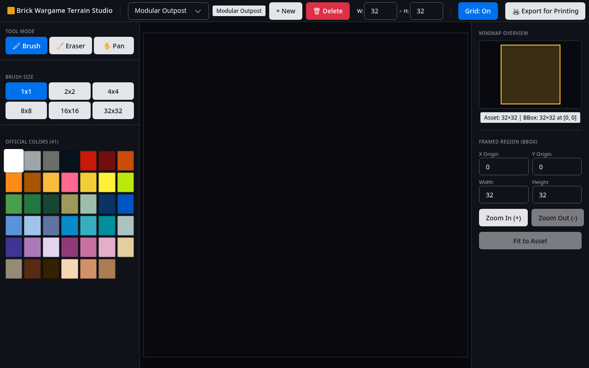

# User Interface Specification (UI & UX)

This directory defines the visual ergonomics, functional component hierarchy, and interaction rules for the **Brick Wargame Terrain Studio** UI.

---

## 1. Visual Mockups & Layout Architecture



Declarative HTML mockups authored with Web Awesome (`@awesome.me/webawesome`) serve as the visual and structural contract:
- [`mockups/main_editor.html`](./mockups/main_editor.html) ([Visual PNG](./mockups/main_editor.png)): Full studio editor view ($1280\times 800$) with header, toolbox, canvas viewport, and inspector.
- [`mockups/delete_asset_modal.html`](./mockups/delete_asset_modal.html) ([Visual PNG](./mockups/delete_asset_modal.png)): Active deletion confirmation dialog overlay.

The UI is structured into 6 cohesive components matching the layout:

```text
<StudioApp> (index.md)
├── <TopHeaderBar>               -> top_header_bar.md (Branding, Asset Selector, +New, Delete, Dimensions WxH, Grid Toggle, Export)
├── <div class="studio-workspace">
│   ├── <LeftToolboxSidebar>     -> left_toolbox_sidebar.md (Brush/Eraser/Pan, Brush Sizes 1x1 up to 32x32, 41 Color Swatches)
│   ├── <CanvasViewport>         -> canvas_viewport.md (Interactive 2D Canvas of Active Bounding Box, Best-Fit No Scrolling)
│   └── <RightInspectorSidebar>  -> right_inspector_sidebar.md (Minimap Overview, Bounding Box Inputs, Zoom In/Out & Fit to Asset)
│       └── <Minimap>            -> minimap.md (Whole Asset Overview with Bounding Box Indicator)
└── <DeleteAssetModal>           -> delete_asset_modal.md (Accessible Destructive Confirmation Dialog)
```

---

## 2. Component Specification Index

* **[`top_header_bar.md`](./top_header_bar.md)**: Studio branding identity, asset switching dropdown, new asset action, delete asset trigger, width/height dimensions inputs, grid toggle, and image export.
* **[`left_toolbox_sidebar.md`](./left_toolbox_sidebar.md)**: Tool mode selector (Brush, Eraser, Pan), brush size presets ($1\times 1, 2\times 2, 4\times 4, 8\times 8, 16\times 16, 32\times 32$), and 41 official brick color swatches displayed as 1x1 flat squares.
* **[`canvas_viewport.md`](./canvas_viewport.md)**: High-performance interactive HTML5 2D canvas displaying the **active bounding box region**, scaled to best fit the viewport with no scrolling, click-to-paint mechanics, flat continuous studs, and optional 1px grid overlay.
* **[`right_inspector_sidebar.md`](./right_inspector_sidebar.md)**: Hosts the `<Minimap>` whole-asset overview, numerical coordinate inputs ($x, y, w, h$) with input rejection, framing actions ("Fit to Asset", "Zoom In", "Zoom Out").
* **[`minimap.md`](./minimap.md)**: Displays the entire $W \times H$ asset with a visual indicator showing where the active bounding box sits within the full terrain.
* **[`bounding_box_state.md`](./bounding_box_state.md)**: Encapsulated Bounding Box State Store, coordination across Viewport, Minimap, and Inspector, and clamping invariants.
* **[`viewport_storage.md`](./viewport_storage.md)**: Viewport Storage Service contract, swappable persistence adapters (`LocalStorageViewportStorage`, `MemoryViewportStorage`), error resilience, and key format.
* **[`delete_asset_modal.md`](./delete_asset_modal.md)**: Semantic accessible modal dialog requiring explicit confirmation before permanent asset deletion.
* **[`design_system.md`](./design_system.md)**: Adoption of Web Awesome with the official dark theme, architectural principles, and allowed domain exceptions.

---

## 3. UI Acceptance Scenarios Index

Located under [`features/`](./features/):
* [`header.feature`](./features/header.feature): Asset switching, new asset creation, dimension updates, grid toggle, and delete confirmation modal flows.
* [`toolbox.feature`](./features/toolbox.feature): Tool modes (brush, eraser, pan), brush sizes, palette selection.
* [`viewport.feature`](./features/viewport.feature): Interactive grid painting with continuous cells, eraser clearing, viewport drag-to-pan, and mouse wheel zoom.
* [`inspector.feature`](./features/inspector.feature): Bounding box adjustments, quick actions (Fit to Asset, Zoom In, Zoom Out, Minimap click-to-center).
* [`persistence.feature`](./features/persistence.feature): Session restoration, self-healing of stale bounding boxes, debounced persistence, and deletion cleanup.
* [`mockup_parity.feature`](./features/mockup_parity.feature): Automated structural and visual parity validation between the live React UI and declarative HTML mockups.

---

## 4. Acceptance Criteria & Test IDs
* `TEST-UI-PARITY-01`: The live React Studio UI structurally and visually matches the declarative HTML mockup `main_editor.html`.
* `TEST-UI-PARITY-02`: The Delete Asset confirmation modal structurally and visually matches the declarative HTML mockup `delete_asset_modal.html`.
