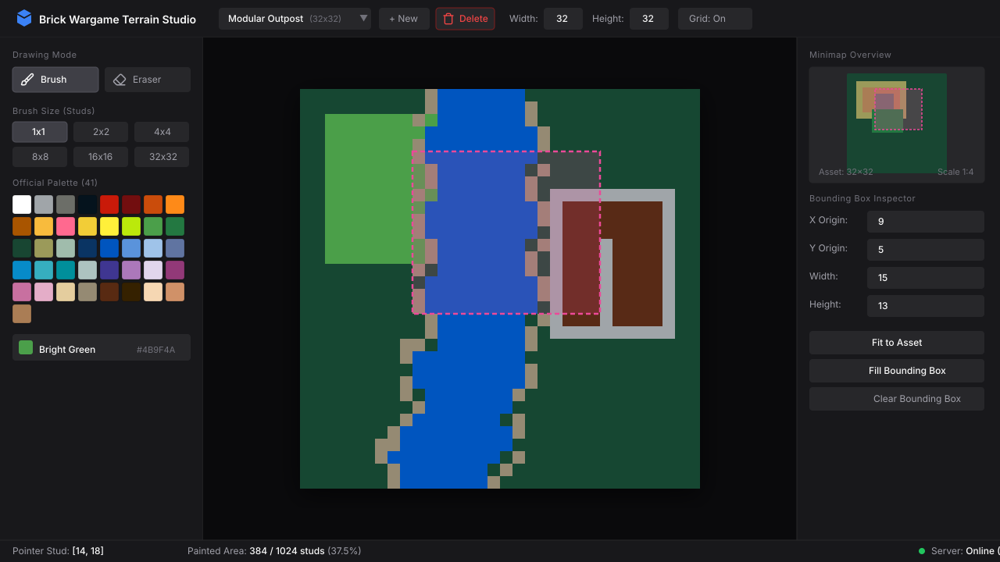

# User Interface Specification (UI & UX)

This directory defines the visual ergonomics, functional component hierarchy, and interaction rules for the **Brick Wargame Terrain Studio** UI.

---

## 1. Visual Mockup & Layout Architecture



The UI is structured into 7 cohesive components matching the layout:

```text
<StudioApp> (index.md)
├── <TopHeaderBar>               -> top_header_bar.md (Branding, Asset Selector, +New, Delete, Dimensions WxH, Grid Toggle)
├── <div className="flex flex-1">
│   ├── <LeftToolboxSidebar>     -> left_toolbox_sidebar.md (Brush/Eraser, Brush Sizes 1x1 up to 32x32, 41 Color Tiles)
│   ├── <CanvasViewport>         -> canvas_viewport.md (Interactive Immediate-Mode HTML5 2D Canvas & BBox Overlay)
│   └── <RightInspectorSidebar>  -> right_inspector_sidebar.md (Minimap & Bounding Box Controls)
│       └── <Minimap>            -> minimap.md (Scaled Overview Thumbnail & Region Viewport Indicator)
├── <BottomStatusBar>            -> bottom_status_bar.md (Cursor Position, Painted Cells Total, Live Sync)
└── <DeleteAssetModal>           -> delete_asset_modal.md (Accessible Destructive Confirmation Dialog)
```

---

## 2. Component Specification Index

* **[`top_header_bar.md`](./top_header_bar.md)**: Clean generic identity ("Brick Wargame Terrain Studio"), asset switching dropdown, new asset action, delete asset trigger, width/height dimensions inputs, and optional grid toggle.
* **[`left_toolbox_sidebar.md`](./left_toolbox_sidebar.md)**: Tool mode selector (Brush vs Eraser), brush size presets ($1\times 1, 2\times 2, 4\times 4, 8\times 8, 16\times 16, 32\times 32$), and 41 official brick color swatches displayed as 1x1 flat squares.
* **[`canvas_viewport.md`](./canvas_viewport.md)**: High-performance interactive HTML5 2D canvas with **continuous stud surfaces by default** (no round nubs, optional reference grid toggle), 60+ FPS immediate-mode painting, and bounding box visual overlay.
* **[`right_inspector_sidebar.md`](./right_inspector_sidebar.md)**: Hosts the minimap overview thumbnail, bounding box numerical inputs ($x, y, w, h$), quick framing actions ("Fit to Asset", "Clear"), and area fill ("Fill BBox").
* **[`minimap.md`](./minimap.md)**: Proportional thumbnail overview of the entire terrain with live cell preview and scaled bounding box indicator.
* **[`bottom_status_bar.md`](./bottom_status_bar.md)**: Live stud cursor coordinates under pointer, painted stud metrics, and real-time backend connection status.
* **[`delete_asset_modal.md`](./delete_asset_modal.md)**: Semantic accessible modal dialog requiring explicit confirmation before permanent asset deletion.

---

## 3. UI Acceptance Scenarios Index

Located under [`features/`](./features/):
* [`header.feature`](./features/header.feature): Asset switching, new asset creation, dimension updates, grid toggle, and delete confirmation modal flows.
* [`toolbox.feature`](./features/toolbox.feature): Tool modes (brush vs eraser), brush sizes, palette selection.
* [`viewport.feature`](./features/viewport.feature): Interactive grid painting with continuous cells, eraser clearing, bounding box visual highlight.
* [`inspector.feature`](./features/inspector.feature): Bounding box adjustments, quick actions (Fit to Asset, Fill Area).
